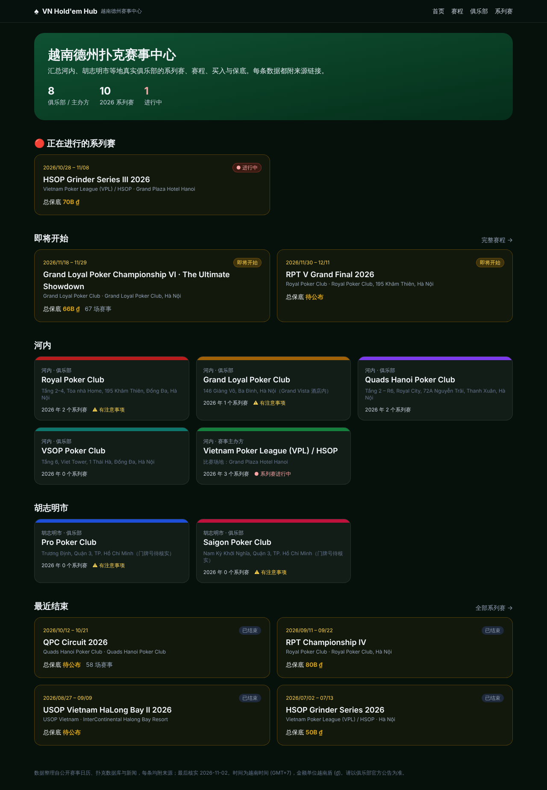
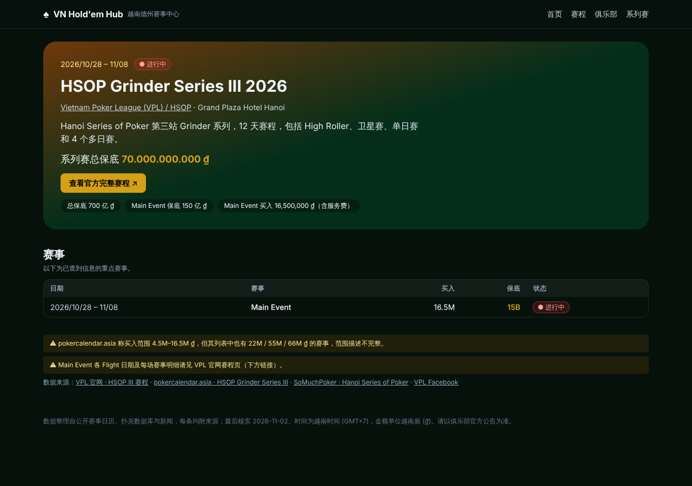
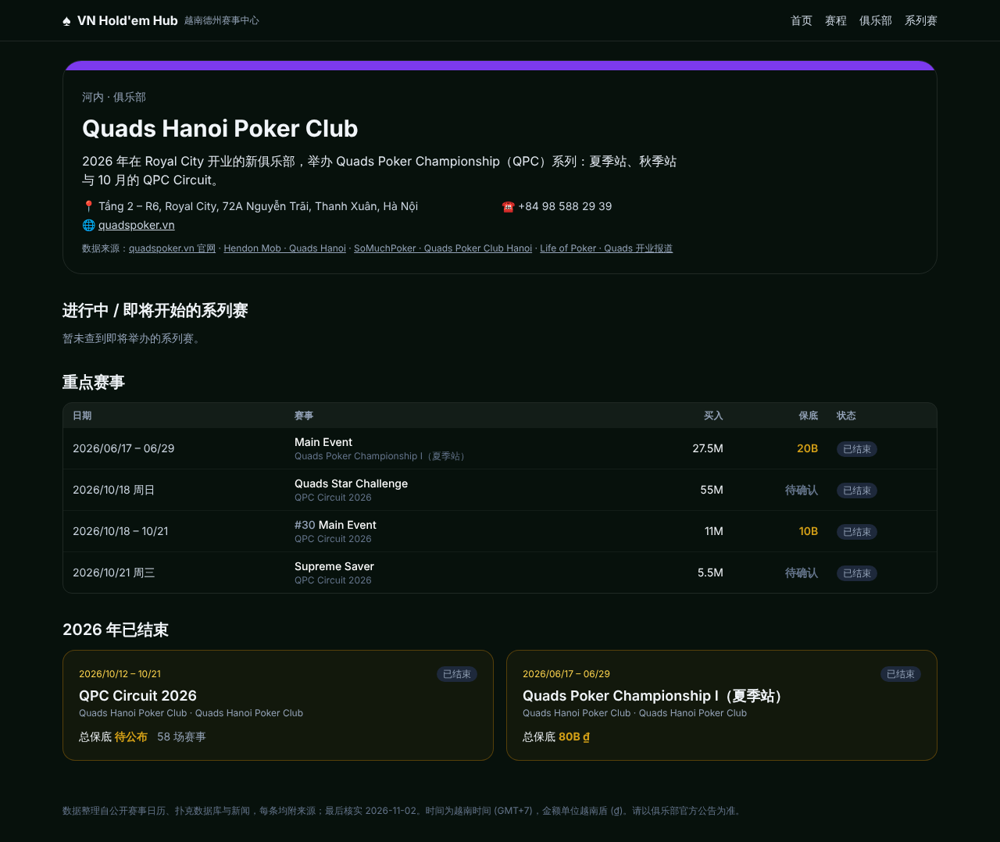
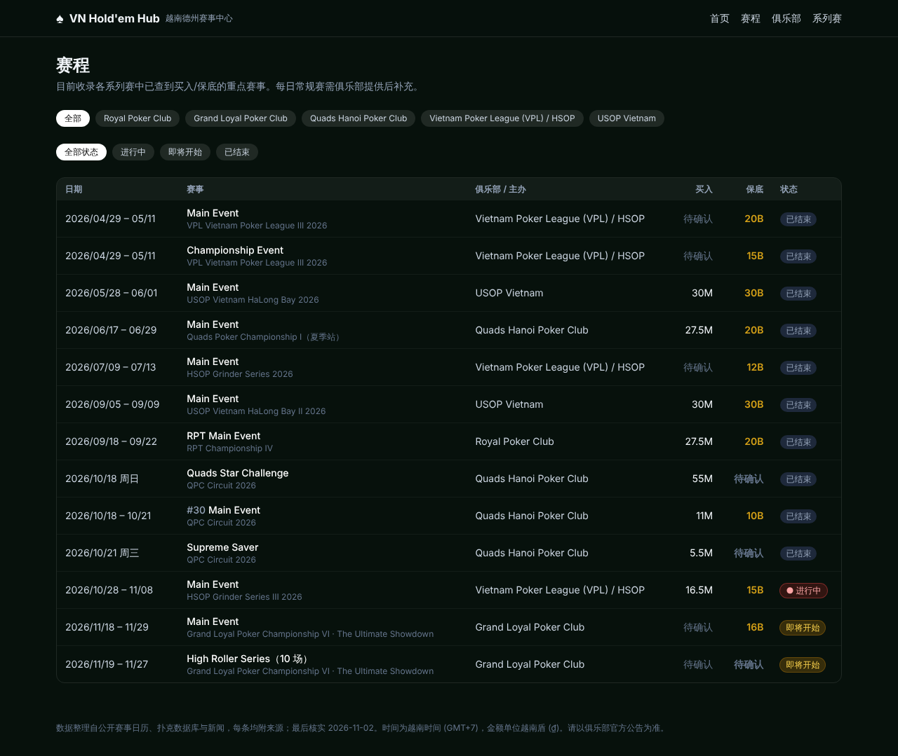
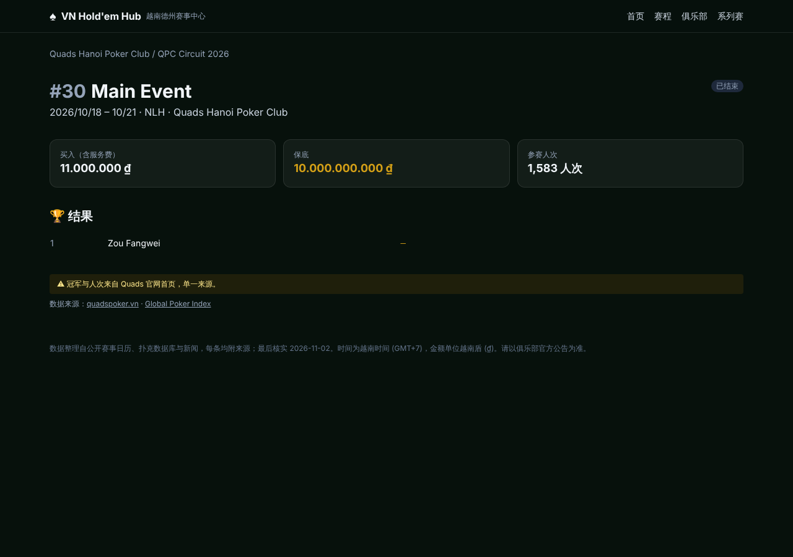
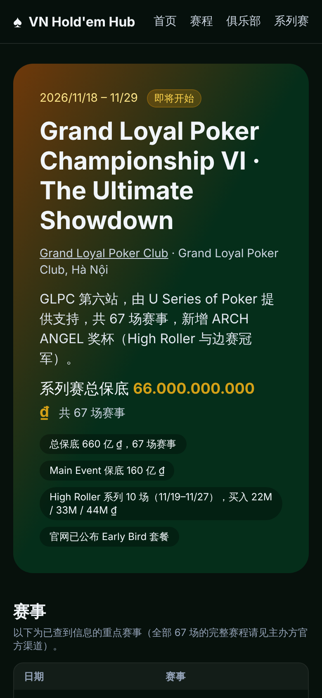

# ♠ VN Hold'em Hub · 越南德州赛事中心

汇总越南各德州扑克俱乐部的 **比赛赛程、买入、奖励结构、系列赛和比赛实况** 的 Web 项目。

> 项目原名 `Helloworld`，现更名为 **VN Hold'em Hub**（package 名 `vn-holdem-hub`）。
> GitHub 仓库名需要在 GitHub → Settings → General → Repository name 里手动改为 `vn-holdem-hub`，
> 改名后旧地址会自动重定向。

## 功能模块

| 页面 | 路径 | 内容 |
|---|---|---|
| 首页 | `/` | 进行中 / 即将开始 / 最近结束的系列赛，河内与胡志明市俱乐部 |
| 赛程 | `/schedule?club=&status=` | 重点赛事列表，可按俱乐部、状态筛选 |
| 俱乐部列表 | `/clubs` | 所有俱乐部卡片 |
| **俱乐部模块** | `/clubs/[slug]` | 每个俱乐部独立页面：地址电话官网、注意事项、旗下系列赛、重点赛事、已结束系列赛 |
| 系列赛列表 | `/series` | 所有系列赛 |
| **系列赛专页** | `/series/[slug]` | 系列赛独立页面：日期场地、总保底、亮点、赛事列表、冠军、来源 |
| **比赛详情 + 实况** | `/tournaments/[id]` | 买入、保底、人次、结果、数据来源；有录入实况时显示级别/盲注、剩余人数、平均筹码、筹码榜、播报 |
| API | `/api/series`、`/api/tournaments` | 系列赛 / 赛事查询（`club` `series` `status`） |
| API | `/api/tournaments/[id]/live` | 实况快照（只返回真实录入的数据） |

## 数据来源与原则

`src/lib/data/` 下全部是**真实俱乐部和 2026 年真实系列赛**，整理自 SoMuchPoker、pokercalendar.asia、
Hendon Mob、PokerAtlas、PokerDiscover、Global Poker Index、俱乐部官网 / Facebook 和越南新闻，
每条记录都带 `sources` 链接，页面上可点击查看。

- 查不到的字段（买入、具体日期等）留空，页面显示“待确认”，**不编造**。
- 来源之间有矛盾的（地址门牌、电话、日期）写在 `warnings` / `notes` 中并在页面上提示。
- 实况数据 `data/live.ts` 目前为空：只放俱乐部或现场人员真实录入的数据，不再生成模拟数据。

收录：Royal Poker Club、Grand Loyal Poker Club、Quads Hanoi Poker Club、VSOP Poker Club、
VPL / HSOP（河内）；Pro Poker Club、Saigon Poker Club（胡志明市）；USOP Vietnam（下龙湾）。

## 本地运行

```bash
npm install
npm run dev     # http://localhost:3000
npm run build   # 生产构建
```

技术栈：Next.js 15 (App Router) + React 19 + TypeScript + Tailwind CSS。

## 目录结构

```
src/
  app/                    页面与 API 路由
  components/             赛程表、实况面板、状态标签、俱乐部卡片
  lib/
    types.ts              数据模型：Club / Series / Tournament / LiveSnapshot
    repo.ts               数据访问层（页面只通过这里取数据）
    data/clubs.ts         真实俱乐部 / 主办方（地址、电话、官网、注意事项、来源）
    data/series.ts        2026 年系列赛
    data/tournaments.ts   重点赛事（主赛事等）
    data/live.ts          实况快照（人工录入）
```

## 数据模型要点

- **Club**：俱乐部或赛事主办方（`kind`），含城市、地址、电话、官网、Facebook、`warnings`、`sources`。
- **Series**：属于某个俱乐部，有起止日期、场地、总保底、赛事数量、`notes`、`sources`；状态（进行中/即将开始/已结束）按日期自动计算。
- **Tournament**：通过 `seriesSlug` 关联系列赛；`buyIn`（含服务费）、`guarantee`、`entries`、`results` 均为可选，缺失显示“待确认”。
- 所有金额单位为越南盾，时间统一按 `Asia/Ho_Chi_Minh` 展示。

## 后续路线图（建议）

0. **自动采集**：写定时脚本抓取 quadspoker.vn、grandloyal.vn、royal-poker.com、SoMuchPoker 赛程页，
   补全每个系列赛的完整赛程（每场的日期、开赛时间、买入、保底、起始筹码、盲注结构）。
1. **真实数据库**：PostgreSQL + Prisma（或 Supabase）。只需重写 `src/lib/repo.ts`。
2. **俱乐部后台**：俱乐部账号登录后录入赛程、更新实况（当前级别、剩余人数、筹码榜、播报）、上传结果；
   `live.ts` 改为读取最新快照。也可对接俱乐部的计时器软件自动同步。
3. **实时推送**：把 30 秒轮询换成 SSE / WebSocket（或 Supabase Realtime / Pusher）。
4. **多语言**：中文 / Tiếng Việt / English / 한국어（next-intl）。
5. **系列赛积分榜**（Player of the Series）、选手个人页、历史战绩。
6. **通知**：Telegram / Zalo 机器人推送开赛提醒、钱圈、决赛桌。
7. **合规**：上线前确认越南当地关于扑克赛事信息发布的法律要求，网站只做信息展示，不涉及线上报名付款。

## 截图

| 首页 | 系列赛专页 | 俱乐部模块 |
|---|---|---|
|  |  |  |

| 赛程 | 比赛详情 | 手机版 |
|---|---|---|
|  |  |  |
